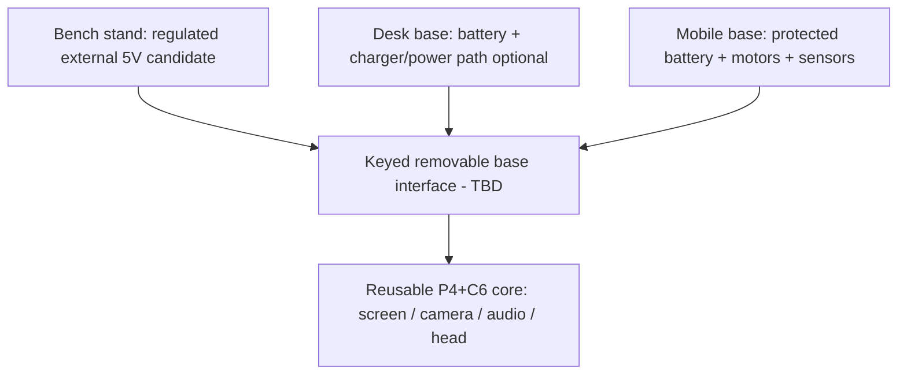

# Base/core electrical and mechanical interface — requirements V0.1

**Status: requirements only. Not a wiring diagram; no connector selected or test performed.**  
Architecture owner: ADR-001.

## Functional diagram

## Requirements matrix
| ID | Requirement | Validation / evidence |
|---|---|---|
| IF-001 | Power supply voltage and maximum current defined from measurements | P4+LCD+camera+audio+servos load profile, connector derating |
| IF-002 | Protected GND, overload/reverse polarity and brownout safe state | electrical test with current-limited supply |
| IF-003 | Mechanical keying and retention, no accessible live contacts | CAD, fit and abuse test |
| IF-004 | Repeated mating and insertion cycles rated for selected part | manufacturer datasheet and physical cycles |
| IF-005 | Base identification/capability protocol; unknown base = no mobility | firmware tests |
| IF-006 | Separate actuator power fault management | bench load test |
| IF-007 | Charging while in use only with appropriate power-path circuit | charger/BMS documentation and test |
| IF-008 | Power-off-only base switching for initial MVP | safe-state test before disconnection |

## Open implementation choices
- Connector: keyed blind-mate vs accessible keyed cable; **no pogo-pin or magnetic connector selected yet**.
- 5 V nominal core input is provisional; evaluate power droop and P4 USB power circuit before selection.
- Decide whether head servos are fed through core or separately via base rail; in both cases protect motor supply.
- If a base controller is added, choose electrically compatible UART/I²C/CAN with its own safe idle on disconnect; no GPIO allocation approved.
- Add mechanical interface dimensions, mounts and full connector envelope once the physical core body is finalized.

## First prototype
Start with a **bench stand/interposer**, an external regulated current-limited power source and an accessible OFF switch. Do not use unprotected Li-ion packs or low-current USB breakout boards to feed stalled servos.

No battery purchase should be marked required for G2 bench bring-up.
